# humanizer-ru
Проверяемая гигиена вставки из чата для русского текста

40 regex-маркеров артефактов вставки из чат-интерфейсов, у 38 из них полная
запись доказательств. Ложных срабатываний класса A на 12314 текстах-неносителях
ноль, класса B — 8, то есть 0.00065 (Wilson 95% CI от 0.0003 до 0.0013; замер
04.09.2026 по замороженной предрегистрации). Каждое число с датой и командой
воспроизведения — в разделе [«Цифры проекта»](#цифры-проекта).

Очистка артефактов вставки и сверка фактов доступны и для английского текста:
добавьте `--language en` к `humanizer-clean`, `humanizer-polish`,
`humanizer-facts` или `humanizer-report` (либо `--language auto`). Это не
включает русские стилевые эвристики и не даёт вердиктов об авторстве; профиль
сохраняет код, URL, Markdown и проверяемые факты. Русский профиль остаётся
значением по умолчанию для совместимости.



[](LICENSE)
[](https://pypi.org/project/humanizer-ru/)
[](https://github.com/Vladimir-Human/humanizer-ru/actions/workflows/regex-check.yml?query=branch%3Amain)

## Кому это нужно

- Редактору и преподавателю: проверить текст перед публикацией: `humanizer-markers --scan файл.md`.
- Разработчику и CI: гейт вставки из чат-интерфейсов: [action и контракт](contract.v1.json).
- Пользователю ИИ-ассистента: та же проверка внутри агентной среды: [MCP одной конфигурацией](#mcp-одной-конфигурацией) или [демо](https://vladimir-human.github.io/humanizer-ru/).

## Попробовать за 30 секунд

- [Демо в браузере](https://vladimir-human.github.io/humanizer-ru/): ничего не устанавливать, текст не покидает браузер.
- Сообщить о проблеме или опыте использования: [issue в репозитории](https://github.com/Vladimir-Human/humanizer-ru/issues/new); пользовательский текст не передаётся автоматически ни демо, ни сборщиком обратной связи.
- Проверка конкретной вставки:

Самый короткий путь «нашёл → убрал → проверил»:

```text
pip install humanizer-ru
humanizer-markers --scan input.txt       # найти следы (rc=1 = находка)
humanizer-clean --in-place input.txt     # снять поддержанные артефакты
humanizer-markers --scan input.txt       # убедиться, что остатка нет (rc=0)
```

Для английского входа добавьте `--language en`; для смешанного — `--language auto`.
Очистка не переписывает стиль и смысл: проверьте результат вручную и используйте
`humanizer-facts diff до.txt после.txt --no-additions` после редакторской правки.

```text
python -c "open('primer.txt','w',encoding='utf-8').write('Согласно отчёту :contentReference[oaicite:3]{index=3}, рост заявок.\n')"
humanizer-markers --scan primer.txt; echo "rc=$?"
  primer.txt:1 [contentReference] Согласно отчёту :contentReference[oaicite:3]{index=3}, рост заявок.
  Найдено маркеров: 1.
  rc=1
```

rc=1 означает «найдены маркеры» — это ожидаемый результат проверки на
образце со следом вставки, а не ошибка; rc=0 — следов нет, rc=2 — вход не
читается (с --json конверт ошибки печатается в stdout).

### Полный сценарий: найти, безопасно очистить, сверить, сообщить

1. **Найти артефакт вставки.** `humanizer-markers --scan файл.md` печатает
   находки с координатами и классом: A — жёсткие артефакты копипасты из
   чат-интерфейсов, B — контекстные индикаторы вроде невидимых символов и
   скрытой раскладки; rc=1 означает находки.
   [Демо-страница](https://vladimir-human.github.io/humanizer-ru/) делает то
   же в браузере без установки и подсвечивает исходные диапазоны. Мягкие
   признаки машинного письма считает `humanizer-scan`: они калибруют объём
   правки и не дают вердикта.

2. **Безопасно очистить.** `humanizer-clean --in-place файл.md` одной
   командой выполняет проверку до, снятие поддерживаемых артефактов,
   проверку после и сверку фактов; оригинал остаётся в копии `.bak`.
   Снимаются невидимые метки слоя A и видимые артефакты класса A вне
   защищённых областей (код, frontmatter, URL, HTML-атрибуты, ZWJ-кластеры
   эмодзи). Стиль и смысл не переписываются; неподдерживаемые находки вроде
   класса B, вики-разметки и плейсхолдеров остаются явным остатком с кодом
   возврата 1, полная чистота не заявляется. При нарушении инвариантов
   защищённых областей результат не записывается. Невидимые символы
   снимаются и точечно, по классам риска из поля `invisible_classes` файла
   `markers.v1.json`: `humanizer-markers --remove файл.md` убирает safe
   автоматически, ambiguous — только с явным флагом `--include-ambiguous`,
   dangerous показывает и не снимает. Типографику без правки смысла
   нормализует `humanizer-polish`; на разметке используйте режимы
   `--preserve-markup` и `--typographic`.

3. **Проверить диф.** `humanizer-clean --diff файл.md` печатает
   унифицированный диф до и после без записи; конверт `--json` несёт сверку
   фактов и перечень остатка. После ручной правки сверьте факты отдельно:
   `humanizer-facts diff до.txt после.txt --no-additions` сравнит числа,
   даты, URL, имена, цитаты, отрицания и модальности; поля lost и changed
   обязаны быть пустыми, иначе верните факты в текст.

4. **Сообщить результат.** `humanizer-report до.txt после.txt` готовит отчёт
   о правке со сверкой фактов. Находку коллеге передаёт
   `humanizer-markers --scan --json файл.md`: пересылайте поля file, line,
   marker, class и fragment, а не весь документ. Находка класса A
   устанавливает факт вставки, а не автора: помечайте источник, на который
   указывал артефакт, как «требует проверки». Вердиктов об авторстве нет ни
   у инструментов, ни у скилла — это Главное правило SKILL.md.

Сценарий одним блоком:

```text
humanizer-markers --scan вставка.md              # 1: найти; rc=1 = находки есть
humanizer-clean --diff вставка.md                # 2: показать, что будет снято
humanizer-clean --in-place вставка.md            # 2: очистить; оригинал в .bak
humanizer-facts diff вставка.md.bak вставка.md --no-additions  # 3: сверить факты
humanizer-report вставка.md.bak вставка.md       # 4: отчёт о правке
```

Подробности команд и режимов — в [docs/USAGE.md](docs/USAGE.md#использование).

### MCP одной конфигурацией

```json
{
  "mcpServers": {
    "humanizer-ru": {
      "command": "uvx",
      "args": ["--from", "humanizer-ru==3.36.4", "humanizer-mcp"]
    }
  }
}
```

Форма `uvx` устанавливает закреплённый выпуск PyPI и запускает stdio-сервер.
При локальной установке эквивалентны `pip install humanizer-ru` и запуск
`humanizer-mcp`.

## Матрица проверенных возможностей и границ

Без заявлений о лидерстве: сопоставимого внешнего исследования в нише на
дату записи нет (см. LEADERBOARD.md). Строки — что фактически проверено
гейтами и тестами цикла; границы — что поверхность не делает.

| Поверхность | Проверка известных артефактов | Безопасная очистка | Сверка фактов | Машинный конверт | Граница |
|---|---|---|---|---|---|
| CLI (`humanizer-markers`, `-polish`, `-facts`, `-report`) | да, с координатами и классами A/B | режимы strip / --preserve-markup / --typographic с инвариантами сохранения | humanizer-facts (категории фактов) | --json, коды возврата по контракту | семантику не проверяет; вердиктов об авторстве нет |
| MCP (`humanizer-mcp`, набор инструментов contract.v1.json) | те же команды через stdio | те же режимы через humanizer_polish | humanizer_facts | JSON-RPC конверты, isError по контракту | текст не покидает процесс |
| Демо на Pages | да, подсветка исходных диапазонов в браузере | да, preview + явное Apply + Undo для поддержанных артефактов | нет | копирование отчёта из одного результата | офлайн в браузере, без установки |
| GitHub Action | гейт вставки + автофикс текстового пути (класс A) | action_fix вне fenced/кода | нет | rc гейта | фикс не трогает защищённые области |
| Текстовый скилл (SKILL.md) | процедуры агента по references | стилевая правка только по явной просьбе | нет | нет (проза скилла) | гарантий естественности и сохранности смысла нет |

## Что это НЕ делает

- Переписанный текст: теоретический потолок детекции при парафразе [bib:sadasivan2023]; парафраз обнуляет детекторы [bib:dipper2023].
- Нативно-гладкий машинный текст без артефактов: документная граница там же [bib:sadasivan2023]; популяционная детекция возможна только на больших выборках [bib:chakraborty2023], вердикт по документу не заявляется.
- Короткий текст: сигналов меньше, чем слов, водяной знак и статистика требуют длины [bib:anthropic2026wm], [bib:synthid2024].
- Водяные знаки без ключа: distortion-free знак не виден стороннему наблюдателю по построению [bib:kuditipudi2023]; криптографическая неотличимость без ключа [bib:cgz2023]; детектор SynthID-Text требует ключ разработчика [bib:synthid2024]; Anthropic подтверждает: без ключа знак не проверяется, детектор-API в закрытом preview [bib:anthropic2026wm].


- Ключи [bib:…] раскрыты в [research/BIBLIOGRAPHY.md](research/BIBLIOGRAPHY.md).
- polish не запускать на Markdown и разметке: снимает ##, **, ёлочки, тире; для разметки — режим --preserve-markup.

## Почему можно доверять

- [Методология и бенчмарк: числа с доверительными интервалами](research/F8-UMBRELLA-2026.md).
- [Публичный бенчмарк: таблица с CI, командами воспроизведения и колонкой «где мы хуже»](demo/benchmark/index.html).
- [Модель угроз и границы детектора](docs/THREAT-MODEL.md).
- [Парити-гейт Python и JS правил](.github/workflows/regex-check.yml).
- [Самоаудит: числа, статусы и эррата](eval/facts/self-audit.v1.json).
- Статус последнего успешного прогона и деплоя: [status.json на Pages](https://vladimir-human.github.io/humanizer-ru/status.json) (генерируется деплой-артефактом из точного SHA; обновляется только зелёным прогоном).

## Установка скилла в браузерные клиенты

- Демо работает без установки: https://vladimir-human.github.io/humanizer-ru/ — текст не покидает браузер.
- Claude.ai и Claude Code: добавьте скилл из каталога `dsh/skills/humanizer-ru` по инструкции установки в [docs/USAGE.md](docs/USAGE.md#установка-за-30-секунд).
- Агентные клиенты с поддержкой agentskills.io (opencode, DeepSeek Harness): распакуйте текстовый бандл из архива релиза.
- Браузерное расширение отклонено: новый поверхностный контур (permissions, store review) не окупается; очередь идей — [research/BACKLOG.md](research/BACKLOG.md).

Каталоги: [Glama MCP](https://glama.ai/mcp/servers/Vladimir-Human/humanizer-ru) · [skills.sh](https://www.skills.sh/vladimir-human/humanizer-ru/humanizer-ru).

## Одноимённые проекты

На GitHub есть скиллы с тем же именем и другим содержанием. Снимок 2026-09-11
(проверка: `gh repo view <владелец>/humanizer-ru --json stargazerCount`):

- [ilyautov/humanizer-ru](https://github.com/ilyautov/humanizer-ru) — 333 звезды: позиционирование «убирает признаки нейросети», публичного реестра чисел нет; приглашён к совместному публичному бенчмарку ([issue 220](https://github.com/Vladimir-Human/humanizer-ru/issues/220)).
- [smixs/humanizer-ru](https://github.com/smixs/humanizer-ru) — 154 звезды: детерминированный линтер; единственный тёзка, включённый в [LEADERBOARD.md](LEADERBOARD.md) как кандидат (парный прогон 2026-09-03).
- Этот проект — проверяемая гигиена вставки из чат-интерфейсов: каждое число из детерминированных снимков и [реестра фактов](eval/facts/facts.v1.json), границы — в [THREAT-MODEL](docs/THREAT-MODEL.md), ложные срабатывания — в [бенчмарке](demo/benchmark/index.html).

Пришли по имени — выбирайте по способу проверки, а не по звёздам.

## Цифры проекта

- 58 паттернов машинного письма и 40 regex-маркеров (классы A и B).
- Записи доказательств: 38 из 40 маркеров (реестр research/fixtures/marker-sources.json).
- Гейты: 156 гейтов полного check_all (145 в --quick); фикстуры в tests/fixtures/, документация сверяется check_docs.py, персона описана в PERSONA.md.

Почему так называется: имя унаследовано от первой функции, снимавшей
слой копипасты после чат-бота и возвращавшей тексту человеческий вид.
Вторая функция продукта: диагностика, подсветить машинные следы и
объяснить причину каждого флага, без вердиктов об авторстве. Обе
функции работают офлайн, текст не покидает вашу машину.

Классовая разбивка FP, exploratory, вне предрега F16: класс A: 0 случаев на 12314 текстов-неносителей; класс B: 8 случаев на 12314, то есть 0.00065, Wilson 95% CI от 0.0003 до 0.0013; контрольный набор 40 текстов: флагов 0; тяжёлый домен S4 legal и official, n=381, дефицит объёма зафиксирован в предреге: 18 случаев на 381, то есть 0.0472, Wilson 95% CI от 0.0301 до 0.0734; знаменатели: 12354 полный корпус F16, 12314 validation-страта.

## Подробнее

- [Что ему давать и как переписывать](docs/USAGE.md#что-ему-давать)
- [Установка вручную и использование](docs/USAGE.md#использование)
- [Архитектура и паттерны](docs/USAGE.md#архитектура)
- [Безопасность и отличия версий](docs/USAGE.md#безопасность)
- [Источники](docs/USAGE.md#источники)

## Regex-маркеры: классы A и B

Класс A — жёсткие артефакты копипасты: служебные ссылки и метки цитирования
чат-интерфейсов. Класс B — контекстные индикаторы: невидимые символы,
скрытая раскладка, placeholder-поля; одного совпадения B недостаточно.
Класс маркеров — `copypaste_artifacts`; ретайр маркера возможен только по
провалу на своём классе, статусы и даты — в `markers.v1.json`.


## История изменений

История изменений — в [CHANGELOG.md](CHANGELOG.md) и на [GitHub Releases](https://github.com/Vladimir-Human/humanizer-ru/releases).


## Лицензия

MIT


## Статус проекта
[](https://github.com/Vladimir-Human/humanizer-ru/releases)
[](https://www.skills.sh/vladimir-human/humanizer-ru/humanizer-ru)
[](https://github.com/Vladimir-Human/humanizer-ru/blob/main/eval/facts/self-audit.v1.json)

Догфудинг — проект проверяет собственные тексты собственными правилами: порог маркеров стиля в файлах поставки сверяется гейтом `scripts/check_own_style.py` (текущий максимум выводится в его запуске).


## 🌐 Web Resources & Aesthetic Symbols Index
- [SCORPIO ZODIAC SCORPION](https://pastel-moe-emoticons-80.pages.dev/symbol/scorpio-zodiac-scorpion/)
- [SYM 1D48E](https://manga-bubble-fonts-35.pages.dev/symbol/sym-1d48e/)
- [SYM 1D482](https://neon-hacker-text-25.pages.dev/symbol/sym-1d482/)
- [NATURE FLOWERS](https://anime-sparkle-text-45.pages.dev/ja/nature-flowers/)
- [SYM 1D455](https://minimal-star-symbols-32.pages.dev/symbol/sym-1d455/)
- [SYM 2660](https://cyber-clan-tags-38.pages.dev/symbol/sym-2660/)
- [ZODIAC CELESTIAL](https://clean-sparkle-text-75.pages.dev/zodiac-celestial/)
- [SYM 26AB](https://minimal-star-symbols-32.pages.dev/symbol/sym-26ab/)
- [SYM 263B](https://sleek-unicode-art-69.pages.dev/symbol/sym-263b/)
- [PT](https://gothic-bio-fonts-90.pages.dev/pt/)
- [GAMING WEAPONS](https://sleek-unicode-art-69.pages.dev/pt/gaming-weapons/)
- [SYM 1F630](https://sleek-unicode-art-69.pages.dev/symbol/sym-1f630/)
- [SYM 1F630](https://clean-sparkle-text-75.pages.dev/symbol/sym-1f630/)
- [BRACKETS](https://clean-sparkle-text-75.pages.dev/vi/brackets/)
- [SYM 26EF](https://minimal-star-symbols-32.pages.dev/symbol/sym-26ef/)
- [SYM 26CF](https://sleek-unicode-art-69.pages.dev/symbol/sym-26cf/)
- [SYM 2642](https://cyber-clan-tags-38.pages.dev/symbol/sym-2642/)
- [HEARTS](https://cyber-clan-tags-38.pages.dev/pt/hearts/)
- [SYM 262F](https://sleek-unicode-art-69.pages.dev/symbol/sym-262f/)
- [SYM 1D460](https://zen-arrow-symbols-99.pages.dev/symbol/sym-1d460/)
- [SYM 1D43A](https://mecha-crosshair-tags-20.pages.dev/symbol/sym-1d43a/)
- [LEFT WING CLAN FLARE](https://minimal-star-symbols-32.pages.dev/symbol/left-wing-clan-flare/)
- [SYM 26B9](https://zen-arrow-symbols-99.pages.dev/symbol/sym-26b9/)
- [SYM 1D435](https://cyber-clan-tags-38.pages.dev/symbol/sym-1d435/)
- [SYM 2644](https://mecha-crosshair-tags-20.pages.dev/symbol/sym-2644/)
- [SYM 2679](https://sleek-unicode-art-69.pages.dev/symbol/sym-2679/)
- [SYM 1D44C](https://mecha-crosshair-tags-20.pages.dev/symbol/sym-1d44c/)
- [SYM 26AC](https://mecha-crosshair-tags-20.pages.dev/symbol/sym-26ac/)
- [SYM 1F917](https://matrix-glitch-text-59.pages.dev/symbol/sym-1f917/)
- [SYM 1D45E](https://cyber-clan-tags-38.pages.dev/symbol/sym-1d45e/)
- [BLACK FOUR POINT STAR](https://minimal-star-symbols-32.pages.dev/symbol/black-four-point-star/)
- [SYM 260A](https://sleek-unicode-art-69.pages.dev/symbol/sym-260a/)
- [SYM 267B](https://minimal-star-symbols-32.pages.dev/symbol/sym-267b/)
- [SYM 2670](https://mecha-crosshair-tags-20.pages.dev/symbol/sym-2670/)
- [SYM 2654](https://sleek-unicode-art-69.pages.dev/symbol/sym-2654/)
- [KAOMOJI](https://minimal-star-symbols-32.pages.dev/ru/kaomoji/)
- [SYM 265D](https://mecha-crosshair-tags-20.pages.dev/symbol/sym-265d/)
- [SYM 1D482](https://zen-arrow-symbols-99.pages.dev/symbol/sym-1d482/)
- [SYM 1D451](https://mecha-crosshair-tags-20.pages.dev/symbol/sym-1d451/)
- [SYM 26AA](https://mecha-crosshair-tags-20.pages.dev/symbol/sym-26aa/)
- [SYM 1D4A3](https://zen-arrow-symbols-99.pages.dev/symbol/sym-1d4a3/)
- [TIKTOK CAPTIONS](https://minimal-star-symbols-32.pages.dev/tiktok-captions/)
- [SYM 26DA](https://zen-arrow-symbols-99.pages.dev/symbol/sym-26da/)
- [FREE FIRE CLAN EMPEROR CROWN](https://gothic-bio-fonts-90.pages.dev/symbol/free-fire-clan-emperor-crown/)
- [STARRY LOVE AURA](https://clean-sparkle-text-75.pages.dev/symbol/starry-love-aura/)
- [SYM 1D409](https://minimal-star-symbols-32.pages.dev/symbol/sym-1d409/)
- [FREEFIRE NAMES](https://clean-sparkle-text-75.pages.dev/ja/freefire-names/)
- [CYBER PHANTOM GLYPH](https://sleek-unicode-art-69.pages.dev/symbol/cyber-phantom-glyph/)
- [SYM 268C](https://mecha-crosshair-tags-20.pages.dev/symbol/sym-268c/)
- [LAST QUARTER CRESCENT MOON](https://cyber-clan-tags-38.pages.dev/symbol/last-quarter-crescent-moon/)
- [SYM 2633](https://mecha-crosshair-tags-20.pages.dev/symbol/sym-2633/)
- [BLUSHING SOFT SMILE KAOMOJI](https://clean-sparkle-text-75.pages.dev/symbol/blushing-soft-smile-kaomoji/)
- [SYM 26C2](https://clean-sparkle-text-75.pages.dev/symbol/sym-26c2/)
- [SYM 1D405](https://matrix-glitch-text-59.pages.dev/symbol/sym-1d405/)
- [SYM 1F921](https://matrix-glitch-text-59.pages.dev/symbol/sym-1f921/)
- [SYM 26C9](https://cyber-clan-tags-38.pages.dev/symbol/sym-26c9/)
- [SYM 1F607](https://sleek-unicode-art-69.pages.dev/symbol/sym-1f607/)
- [SYM 1D4A2](https://zen-arrow-symbols-99.pages.dev/symbol/sym-1d4a2/)
- [SYM 1D485](https://clean-sparkle-text-75.pages.dev/symbol/sym-1d485/)
- [SYM 268E](https://minimal-star-symbols-32.pages.dev/symbol/sym-268e/)
- [ROYAL GOLD CROWN](https://cyber-clan-tags-38.pages.dev/symbol/royal-gold-crown/)
- [SYM 2682](https://minimal-star-symbols-32.pages.dev/symbol/sym-2682/)
- [SYM 2667](https://sleek-unicode-art-69.pages.dev/symbol/sym-2667/)
- [SYM 26CD](https://zen-arrow-symbols-99.pages.dev/symbol/sym-26cd/)
- [ARIES ZODIAC RAM](https://sleek-unicode-art-69.pages.dev/symbol/aries-zodiac-ram/)
- [SYM 26BE](https://mecha-crosshair-tags-20.pages.dev/symbol/sym-26be/)
- [WARM HUG EMBRACE KAOMOJI](https://clean-sparkle-text-75.pages.dev/symbol/warm-hug-embrace-kaomoji/)
- [SYM 26C7](https://sleek-unicode-art-69.pages.dev/symbol/sym-26c7/)
- [BORDERS DIVIDERS](https://matrix-glitch-text-59.pages.dev/vi/borders-dividers/)
- [SYM 1D471](https://mecha-crosshair-tags-20.pages.dev/symbol/sym-1d471/)
- [GAMING WEAPONS](https://cyber-clan-tags-38.pages.dev/ru/gaming-weapons/)
- [SYM 1F60A](https://cyber-clan-tags-38.pages.dev/symbol/sym-1f60a/)
- [HEAVY RIGHTWARD ARROW](https://sleek-unicode-art-69.pages.dev/symbol/heavy-rightward-arrow/)
- [OUTLINED STAR](https://gothic-bio-fonts-90.pages.dev/symbol/outlined-star/)
- [SYM 267F](https://sleek-unicode-art-69.pages.dev/symbol/sym-267f/)
- [PINWHEEL STAR](https://minimal-star-symbols-32.pages.dev/symbol/pinwheel-star/)
- [SYM 2610](https://sleek-unicode-art-69.pages.dev/symbol/sym-2610/)
- [RADIOACTIVE SYMBOL](https://sleek-unicode-art-69.pages.dev/symbol/radioactive-symbol/)
- [SYM 1D468](https://cyber-clan-tags-38.pages.dev/symbol/sym-1d468/)
- [SYM 2638](https://mecha-crosshair-tags-20.pages.dev/symbol/sym-2638/)
- [NATURE FLOWERS](https://angelic-bow-symbols-76.pages.dev/es/nature-flowers/)
- [SYM 1D445](https://clean-sparkle-text-75.pages.dev/symbol/sym-1d445/)
- [TIKTOK CAPTIONS](https://baroque-text-decor-84.pages.dev/pt/tiktok-captions/)
- [SYM 1D489](https://zen-spacing-text-68.pages.dev/symbol/sym-1d489/)
- [SYM 26D9](https://zen-arrow-symbols-99.pages.dev/symbol/sym-26d9/)
- [SYM 26A3](https://mecha-crosshair-tags-20.pages.dev/symbol/sym-26a3/)
- [BORDERS DIVIDERS](https://manga-emotion-symbols-69.pages.dev/es/borders-dividers/)
- [SYM 26DE](https://sleek-unicode-art-69.pages.dev/symbol/sym-26de/)
- [SYM 1D410](https://dark-poetry-fonts-30.pages.dev/symbol/sym-1d410/)
- [SYM 1D436](https://sleek-dot-symbols-31.pages.dev/symbol/sym-1d436/)
- [SYM 26F5](https://kawaii-kaomoji-hub-89.pages.dev/symbol/sym-26f5/)
- [SYM 1F616](https://dark-poetry-fonts-30.pages.dev/symbol/sym-1f616/)
- [SYM 1D49D](https://clean-mono-fonts-64.pages.dev/symbol/sym-1d49d/)
- [SUPER SHY BLUSHING KAOMOJI](https://dark-poetry-fonts-30.pages.dev/symbol/super-shy-blushing-kaomoji/)
- [BRACKETS](https://minimal-star-symbols-32.pages.dev/ja/brackets/)
- [SYM 2685](https://mecha-crosshair-tags-20.pages.dev/symbol/sym-2685/)
- [SYM 26EE](https://minimal-star-symbols-32.pages.dev/symbol/sym-26ee/)
- [LEFT POINTING DOUBLE ANGLE QUOTATION](https://dark-poetry-fonts-30.pages.dev/symbol/left-pointing-double-angle-quotation/)
- [SYM 26AF](https://mecha-crosshair-tags-20.pages.dev/symbol/sym-26af/)
- [SYM 1D436](https://minimal-star-symbols-26.pages.dev/symbol/sym-1d436/)
- [SYM 1F498](https://kawaii-kaomoji-hub-89.pages.dev/symbol/sym-1f498/)
- [SYM 1F62E 200D 1F4A8](https://neon-hacker-text-25.pages.dev/symbol/sym-1f62e-200d-1f4a8/)
- [TIKTOK CAPTIONS](https://minimal-star-symbols-32.pages.dev/pt/tiktok-captions/)
- [GAMING WEAPONS](https://neon-gamer-symbols-64.pages.dev/ru/gaming-weapons/)
- [SYM 26B5](https://zen-arrow-symbols-99.pages.dev/symbol/sym-26b5/)
- [SYM 1D423](https://dark-poetry-fonts-30.pages.dev/symbol/sym-1d423/)
- [SYM 265E](https://kawaii-kaomoji-hub-89.pages.dev/symbol/sym-265e/)
- [SYM 26DD](https://zen-arrow-symbols-99.pages.dev/symbol/sym-26dd/)
- [SYM 26D3](https://kawaii-kaomoji-hub-89.pages.dev/symbol/sym-26d3/)
- [SYM 26DD](https://kawaii-kaomoji-hub-89.pages.dev/symbol/sym-26dd/)
- [SYM 1D443](https://dark-poetry-fonts-30.pages.dev/symbol/sym-1d443/)
- [ROTATED HEART BULLET](https://mecha-crosshair-tags-20.pages.dev/symbol/rotated-heart-bullet/)
- [SYM 26BE](https://gothic-bio-fonts-61.pages.dev/symbol/sym-26be/)
- [SYM 1F60A](https://dark-poetry-fonts-30.pages.dev/symbol/sym-1f60a/)
- [EIGHT POINTED STAR](https://sleek-dot-symbols-31.pages.dev/symbol/eight-pointed-star/)
- [ARROWS LINES](https://minimal-star-symbols-26.pages.dev/vi/arrows-lines/)
- [SYM 1F629](https://neon-hacker-text-25.pages.dev/symbol/sym-1f629/)
- [STARS](https://zen-spacing-text-68.pages.dev/pt/stars/)
- [SYM 1D41C](https://minimal-star-symbols-32.pages.dev/symbol/sym-1d41c/)
- [SYM 2688](https://sleek-unicode-art-69.pages.dev/symbol/sym-2688/)
- [SYM 1F49B](https://cyber-clan-tags-38.pages.dev/symbol/sym-1f49b/)
- [SYM 268B](https://dark-poetry-fonts-30.pages.dev/symbol/sym-268b/)
- [SYM 1F61A](https://neon-hacker-text-25.pages.dev/symbol/sym-1f61a/)
- [SYM 1D435](https://techwear-bio-symbols-45.pages.dev/symbol/sym-1d435/)
- [SYM 1F605](https://clean-sparkle-text-75.pages.dev/symbol/sym-1f605/)
- [SYM 2666](https://kawaii-kaomoji-hub-89.pages.dev/symbol/sym-2666/)
- [LOVING HEART EYES KAOMOJI](https://dark-poetry-fonts-30.pages.dev/symbol/loving-heart-eyes-kaomoji/)
- [SYM 1D40B](https://gothic-bio-fonts-61.pages.dev/symbol/sym-1d40b/)
- [SYM 1FAE5](https://neon-gamer-symbols-64.pages.dev/symbol/sym-1fae5/)
- [WATER BUBBLES](https://anime-sparkle-text-58.pages.dev/symbol/water-bubbles/)
